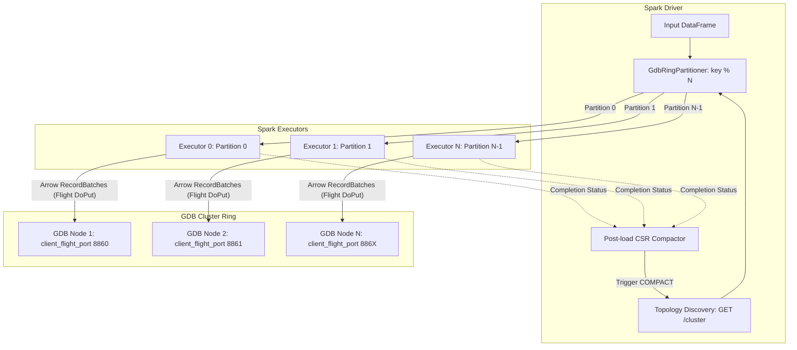

# Apache Spark Connector for GDB (`gdb-spark-connector`)

High-Throughput distributed graph loader and Apache Spark connector for **GDB Graph Database**.

Streams large-scale graph datasets directly from Spark executors into GDB Arrow Flight client ports using native Apache Arrow memory and gRPC streaming.

---

## Key Features

- **Driver Topology Discovery**: The Spark driver connects to the GDB coordinator HTTP endpoint (`GET /cluster`), extracts the cluster ring nodes, their IP addresses, replication factor, and dedicated external `client_flight_port`s.
- **Direct Executor Arrow Flight Streaming**: Spark executors convert DataFrame partitions into Apache Arrow `RecordBatch`es and stream them concurrently via `FlightClient.startPut` directly to the `client_flight_port` of the target primary GDB node (`vid % N` for vertices, `src % N` for edges).
- **Pre-Shuffle Alignment via `GdbRingPartitioner`**: Avoids cross-node fanout and connection thrashing by partitioning the Spark DataFrame across the $N$ GDB ring nodes before writing.
- **Dual API Support**:
  1. **Spark DataSource V2 (`format("gdb")`)**: Standard Spark SQL batch write `df.write.format("gdb").options(...).save()`.
  2. **High-Performance Bulk Loader (`GdbSparkLoader`)**: Direct programmatic API for maximum throughput with custom chunking and schema inference.
- **Automatic Post-Load Compaction**: Optionally triggers CSR compaction on all cluster nodes immediately after write completion for instant openCypher query readiness.
- **Cross-Platform / Hybrid**:
  - **Scala/Java Connector**: Spark 3.4/3.5, Scala 2.12/2.13, sbt + Maven builds.
  - **PySpark Module (`gdb_spark`)**: Native Python package using `pyarrow.flight`.

---

## Architecture



---

## Configuration Options

| Option | Default | Description |
|---|---|---|
| `url` / `gdb.url` | `http://localhost:8847` | GDB Coordinator HTTP URL for topology discovery and compaction |
| `type` / `gdb.type` | `vertex` | Entity type: `"vertex"` or `"edge"` |
| `label` / `gdb.label` | `_default` | Vertex label (e.g. `User`, `Company`) |
| `edgeType` / `gdb.edgeType` | `DEFAULT` | Edge type (e.g. `FOLLOWS`, `TRANSFERS`) |
| `idCol` / `gdb.idCol` | `id` | Column name representing the Vertex ID |
| `srcCol` / `gdb.srcCol` | `src` | Column name representing the Edge Source Vertex ID |
| `dstCol` / `gdb.dstCol` | `dst` | Column name representing the Edge Target Vertex ID |
| `rankCol` / `gdb.rankCol` | `rank` | Optional column name representing Edge rank (defaults to 0 if omitted) |
| `batchSize` / `gdb.batchSize` | `16384` | Maximum number of rows per Arrow `RecordBatch` |
| `repartitionByRing` | `true` | Pre-partition DataFrame by GDB token ring (`key % N`) |
| `compact` / `gdb.compact` | `true` | Automatically trigger CSR compaction after bulk loading |
| `timeoutMs` | `30000` | Connection and query timeout in milliseconds |

---

## Usage: Scala / Java Spark

### 1. High-Performance Bulk Loader API (`GdbSparkLoader`)

```scala
import org.apache.spark.sql.SparkSession
import org.apache.spark.sql.gdb.{GdbOptions, GdbSparkLoader}

val spark = SparkSession.builder().appName("GdbIngest").getOrCreate()

// Ingest Vertices
val usersDf = spark.read.parquet("hdfs:///data/users.parquet")
val vSummary = GdbSparkLoader.loadVertices(
  usersDf,
  GdbOptions(Map(
    "url" -> "http://gdb-coordinator:8847",
    "label" -> "User",
    "idCol" -> "user_id",
    "batchSize" -> "16384",
    "compact" -> "true"
  ))
)
println(s"Loaded ${vSummary.totalRows} vertices in ${vSummary.elapsedMs}ms (${vSummary.rowsPerSecond} rows/s)")

// Ingest Edges
val followsDf = spark.read.parquet("hdfs:///data/follows.parquet")
val eSummary = GdbSparkLoader.loadEdges(
  followsDf,
  GdbOptions(Map(
    "url" -> "http://gdb-coordinator:8847",
    "edgeType" -> "FOLLOWS",
    "srcCol" -> "source_id",
    "dstCol" -> "target_id",
    "batchSize" -> "16384",
    "compact" -> "true"
  ))
)
println(s"Loaded ${eSummary.totalRows} edges in ${eSummary.elapsedMs}ms (${eSummary.rowsPerSecond} rows/s)")
```

### 2. Spark DataSource V2 (`format("gdb")`)

```scala
// Ingest Vertices via DataSource V2
usersDf.write
  .format("gdb")
  .option("url", "http://gdb-coordinator:8847")
  .option("type", "vertex")
  .option("label", "User")
  .option("idCol", "user_id")
  .option("compact", "true")
  .save()

// Ingest Edges via DataSource V2
followsDf.write
  .format("gdb")
  .option("url", "http://gdb-coordinator:8847")
  .option("type", "edge")
  .option("edgeType", "FOLLOWS")
  .option("srcCol", "source_id")
  .option("dstCol", "target_id")
  .option("compact", "true")
  .save()
```

---

## Usage: PySpark (`gdb_spark`)

```python
from pyspark.sql import SparkSession
from gdb_spark import GdbSparkLoader, GdbOptions

spark = SparkSession.builder.appName("GdbPySpark").getOrCreate()

# 1. Ingest Vertices
df_users = spark.read.parquet("hdfs:///data/users.parquet")
v_summary = GdbSparkLoader.load_vertices(
    df_users,
    options=GdbOptions(
        url="http://gdb-coordinator:8847",
        label="User",
        id_col="user_id",
        batch_size=16384,
        compact=True,
    )
)
print(f"Loaded {v_summary.total_rows} vertices in {v_summary.elapsed_seconds}s")

# 2. Ingest Edges
df_edges = spark.read.parquet("hdfs:///data/follows.parquet")
e_summary = GdbSparkLoader.load_edges(
    df_edges,
    options=GdbOptions(
        url="http://gdb-coordinator:8847",
        edge_type="FOLLOWS",
        src_col="source_id",
        dst_col="target_id",
        batch_size=16384,
        compact=True,
    )
)
print(f"Loaded {e_summary.total_rows} edges in {e_summary.elapsed_seconds}s")
```

---

## Building and Packaging

### sbt
```bash
sbt assembly
```
Produces fat JAR with all Arrow Flight dependencies:
`target/scala-2.12/gdb-spark-connector-0.5.6-spark-3.5.0.jar`

### Maven
```bash
mvn clean package -DskipTests
```

### PySpark Package
```bash
cd python
pip install -e .
```

---

## Running Tests

Integration tests run an in-process mock GDB HTTP coordinator and multiple Arrow Flight servers:

```bash
python3 tests/test_pyspark_flight_loader.py
```
