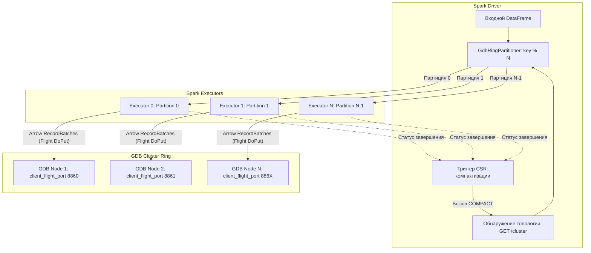

# Apache Spark Connector для GDB (`gdb-spark-connector`)

Высокопроизводительный распределенный коннектор и загрузчик графовых данных для СУБД **GDB** из Apache Spark / PySpark.

Осуществляет прямую потоковую передачу данных с исполнителей (executors) Spark в выделенные Arrow Flight client-порты нод GDB с использованием нативной памяти Apache Arrow и gRPC без лишних промежуточных сериализаций.

---

## Архитектура и принципы работы

- **Обнаружение топологии на драйвере (Driver Topology Discovery)**: Драйвер Spark обращается к координатору GDB по HTTP (`GET /cluster`), считывает актуальные ring-ноды, их IP-адреса, фактор репликации и выделенные порты для внешней заливки данных `client_flight_port`.
- **Прямой стриминг в порты нод (Direct Arrow Flight Streaming)**: Исполнители Spark преобразуют партиции датафреймов в пакеты `RecordBatch` Apache Arrow и параллельно стримят их через `FlightClient.startPut` напрямую в порт `client_flight_port` соответствующей первичной ноды (`vid % N` для вершин, `src % N` для рёбер).
- **Выравнивание партиций через `GdbRingPartitioner`**: Датафрейм Spark предварительно репартиционируется по числу $N$ нод кольца GDB. Каждая партиция Spark сопоставляется ровно одной GDB-ноде, исключая паразитный сетевой трафик между исполнителями.
- **Два режима интеграции**:
  1. **Spark DataSource V2 (`format("gdb")`)**: Стандартная пакетная запись Spark SQL `df.write.format("gdb").options(...).save()`.
  2. **Программный Bulk Loader (`GdbSparkLoader`)**: Высокоскоростной API для пакетной загрузки с гибким управлением размером чанков (`loadVertices` / `loadEdges`).
- **Автоматическая CSR-компактизация**: Драйвер автоматически вызывает `COMPACT;` на нодах кластера после завершения загрузки для мгновенной готовности графа к запросам openCypher.
- **Поддержка двух сред**:
  - **Scala/Java Connector**: Spark 3.4/3.5, Scala 2.12/2.13 (сборка через sbt или Maven).
  - **PySpark модуль (`gdb_spark`)**: Нативный Python-пакет на базе `pyarrow.flight`.

---

## Схема взаимодействия



---

## Параметры конфигурации

| Опция | По умолчанию | Описание |
|---|---|---|
| `url` / `gdb.url` | `http://localhost:8847` | HTTP URL координатора GDB для обнаружения топологии и вызова компактизации |
| `type` / `gdb.type` | `vertex` | Тип сущности: `"vertex"` или `"edge"` |
| `label` / `gdb.label` | `_default` | Метка вершины (например, `User`, `Company`) |
| `edgeType` / `gdb.edgeType` | `DEFAULT` | Тип ребра (например, `FOLLOWS`, `TRANSFERS`) |
| `idCol` / `gdb.idCol` | `id` | Имя колонки, содержащей идентификатор вершины |
| `srcCol` / `gdb.srcCol` | `src` | Имя колонки с ID вершины-источника |
| `dstCol` / `gdb.dstCol` | `dst` | Имя колонки с ID вершины-приемника |
| `rankCol` / `gdb.rankCol` | `rank` | Опциональная колонка с рангом ребра (по умолчанию 0) |
| `batchSize` / `gdb.batchSize` | `16384` | Максимальное количество строк в одном Arrow `RecordBatch` |
| `repartitionByRing` | `true` | Предварительный shuffle по токенам кольца GDB (`key % N`) |
| `compact` / `gdb.compact` | `true` | Автоматический вызов CSR-компактизации после завершения заливки |
| `timeoutMs` | `30000` | Таймаут соединения и сетевых операций в миллисекундах |

---

## Использование в Scala / Java

### 1. Программный API `GdbSparkLoader`

```scala
import org.apache.spark.sql.SparkSession
import org.apache.spark.sql.gdb.{GdbOptions, GdbSparkLoader}

val spark = SparkSession.builder().appName("GdbIngest").getOrCreate()

// Загрузка вершин
val usersDf = spark.read.parquet("hdfs:///data/users.parquet")
val vSummary = GdbSparkLoader.loadVertices(
  usersDf,
  GdbOptions(Map(
    "url" -> "http://gdb-coordinator:8847",
    "label" -> "User",
    "idCol" -> "user_id",
    "batchSize" -> "16384",
    "compact" -> "true"
  ))
)
println(s"Загружено ${vSummary.totalRows} вершин за ${vSummary.elapsedMs}мс (${vSummary.rowsPerSecond} строк/сек)")

// Загрузка рёбер
val followsDf = spark.read.parquet("hdfs:///data/follows.parquet")
val eSummary = GdbSparkLoader.loadEdges(
  followsDf,
  GdbOptions(Map(
    "url" -> "http://gdb-coordinator:8847",
    "edgeType" -> "FOLLOWS",
    "srcCol" -> "source_id",
    "dstCol" -> "target_id",
    "batchSize" -> "16384",
    "compact" -> "true"
  ))
)
println(s"Загружено ${eSummary.totalRows} рёбер за ${eSummary.elapsedMs}мс (${eSummary.rowsPerSecond} строк/сек)")
```

### 2. Spark DataSource V2 (`format("gdb")`)

```scala
// Загрузка вершин через DataSource V2
usersDf.write
  .format("gdb")
  .option("url", "http://gdb-coordinator:8847")
  .option("type", "vertex")
  .option("label", "User")
  .option("idCol", "user_id")
  .option("compact", "true")
  .save()

// Загрузка рёбер через DataSource V2
followsDf.write
  .format("gdb")
  .option("url", "http://gdb-coordinator:8847")
  .option("type", "edge")
  .option("edgeType", "FOLLOWS")
  .option("srcCol", "source_id")
  .option("dstCol", "target_id")
  .option("compact", "true")
  .save()
```

---

## Использование в PySpark (`gdb_spark`)

```python
from pyspark.sql import SparkSession
from gdb_spark import GdbSparkLoader, GdbOptions

spark = SparkSession.builder.appName("GdbPySpark").getOrCreate()

# 1. Загрузка вершин
df_users = spark.read.parquet("hdfs:///data/users.parquet")
v_summary = GdbSparkLoader.load_vertices(
    df_users,
    options=GdbOptions(
        url="http://gdb-coordinator:8847",
        label="User",
        id_col="user_id",
        batch_size=16384,
        compact=True,
    )
)
print(f"Загружено {v_summary.total_rows} вершин за {v_summary.elapsed_seconds}с")

# 2. Загрузка рёбер
df_edges = spark.read.parquet("hdfs:///data/follows.parquet")
e_summary = GdbSparkLoader.load_edges(
    df_edges,
    options=GdbOptions(
        url="http://gdb-coordinator:8847",
        edge_type="FOLLOWS",
        src_col="source_id",
        dst_col="target_id",
        batch_size=16384,
        compact=True,
    )
)
print(f"Загружено {e_summary.total_rows} рёбер за {e_summary.elapsed_seconds}с")
```

---

## Сборка и упаковка

### sbt
```bash
sbt assembly
```
Формирует исполняемый fat JAR со всеми зависимостями Arrow Flight:
`target/scala-2.12/gdb-spark-connector-assembly-0.5.6-spark-3.5.0.jar`

### Maven
```bash
mvn clean package -DskipTests
```

### PySpark модуль
```bash
cd python
pip install -e .
```
